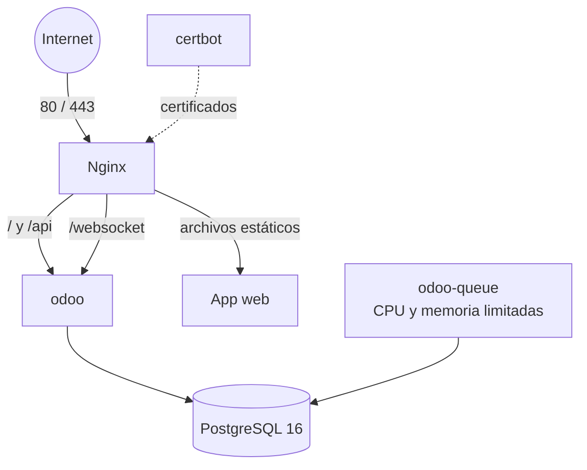

# Planner Docker Infra

Infraestructura de [Planner For Education](https://github.com/Jeisondls/planner-for-education): Odoo, PostgreSQL, Nginx y certificados TLS en contenedores con Docker Compose.

> Los archivos reales son privados. Este documento describe el diseño y las decisiones. No incluye contraseñas, claves ni datos del servidor.

## Servicios

| Servicio | Imagen | Función |
|---|---|---|
| `odoo` | Imagen propia sobre `odoo:17.0` | Aplicación web y API |
| `odoo-queue` | La misma imagen | Procesa la cola de IA y las tareas programadas, sin servidor web |
| `db` | `postgres:16` | Base de datos con volumen persistente |
| `nginx` | `nginx:1.27-alpine` | Entrada pública, TLS, límites de tráfico y archivos de la app web |
| `certbot` | `certbot/certbot` | Emisión y renovación de certificados |

## Arquitectura



## Problemas y soluciones

| Problema | Solución aplicada |
|---|---|
| La generación con IA compite por recursos con la app | Un segundo contenedor con la misma imagen, sin HTTP y con límites de CPU y memoria. El número de hilos de la cola se ajusta por variable de entorno según el tamaño del servidor |
| Odoo no debe quedar expuesto directamente | Odoo escucha solo en `127.0.0.1`. Todo el tráfico público entra por Nginx |
| Arrancar en orden correcto | `depends_on` con condiciones de salud: Odoo espera a que PostgreSQL esté listo, y Nginx a que Odoo responda |
| Detectar contenedores colgados | Healthchecks con reinicio automático (`unless-stopped`) |
| Los PDF salen con tipografías distintas en el servidor | La imagen instala fuentes equivalentes a Arial, Times New Roman, Courier New, Calibri y Cambria |
| Dependencias de Python reproducibles | Se instalan al construir la imagen, no al arrancar |
| Secretos fuera del repositorio | Variables en un archivo `.env` ignorado por git, con un `.env.example` documentado |
| Abuso de la API | Límite de peticiones por cliente en Nginx |
| Cabeceras de seguridad | HSTS, política de contenido, protección contra incrustación y tipo de contenido |
| Publicar la web sin reiniciar | Nginx sirve la app web desde un volumen de solo lectura: se reemplazan los archivos |
| Renovar certificados sin parar el servicio | Certbot con validación `.well-known` servida por Nginx |

## Procedimiento de actualización

```bash
# Tras cambiar modelos, datos o vistas de un módulo
docker compose exec odoo odoo -d <base> -u <modulo> --stop-after-init
docker compose restart odoo odoo-queue

# Si cambian las dependencias de Python, reconstruir la imagen
docker compose build odoo && docker compose up -d
```

## Decisiones técnicas

- **Una imagen, dos roles** (web y cola): menos mantenimiento y comportamiento idéntico.
- **Volúmenes nombrados** para la base de datos y los archivos de Odoo, separados del código.
- **Configuración por archivo** para cada rol (`odoo.conf` y `odoo-queue.conf`).

## Tecnologías

Docker · Docker Compose · PostgreSQL 16 · Nginx · Certbot · Let's Encrypt · Odoo 17

## Relacionado

[Backend Odoo](https://github.com/Jeisondls/planner-odoo-backend) · [App móvil](https://github.com/Jeisondls/planner-mobile) · [Versión web](https://github.com/Jeisondls/planner-web)
