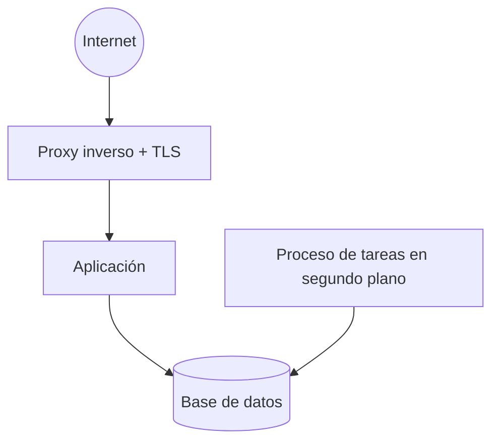

# Planner Docker Infra

Infraestructura de [Planner For Education](https://github.com/Jeisondls/planner-for-education): una aplicación web y su base de datos en contenedores, publicadas detrás de un proxy inverso con TLS.

> Los archivos reales son privados. Este documento resume los principios de diseño y no incluye configuración, versiones ni datos de ningún entorno.

## Arquitectura

## Principios de diseño

| Principio | Enfoque |
|---|---|
| Aislar las tareas pesadas | Las tareas en segundo plano corren en un proceso separado, con recursos acotados, para no afectar la aplicación |
| Superficie de exposición mínima | Solo el proxy inverso recibe tráfico público; el resto de los servicios no es accesible desde fuera |
| Arranque y recuperación fiables | Comprobaciones de salud y reinicio automático |
| Builds reproducibles | Las dependencias se resuelven al construir la imagen, no al arrancar |
| Secretos fuera del repositorio | La configuración sensible se inyecta por entorno y nunca se versiona |
| Despliegues sin interrupción | Certificados y archivos estáticos se renuevan sin detener el servicio |

## Decisiones técnicas

- **Una imagen, varios roles:** menos mantenimiento y comportamiento idéntico entre procesos.
- **Datos separados del código:** el almacenamiento persistente es independiente de las imágenes.
- **Configuración por entorno:** la misma base de código se despliega en distintos entornos sin cambios.

## Tecnologías

Docker · Docker Compose · PostgreSQL · Nginx · TLS · Odoo

## Relacionado

[Proyecto](https://github.com/Jeisondls/planner-for-education) · [Backend](https://github.com/Jeisondls/planner-odoo-backend)
